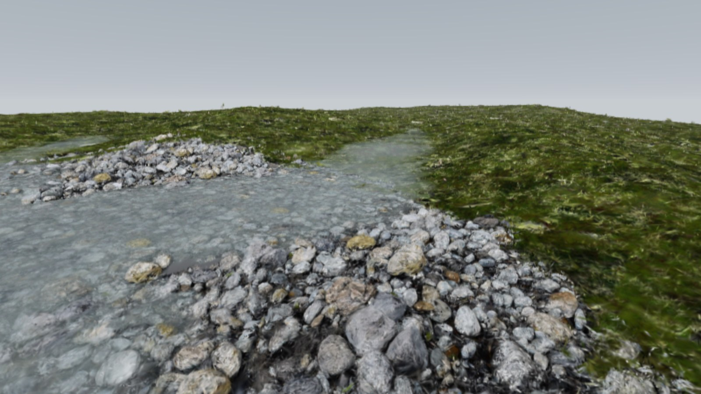
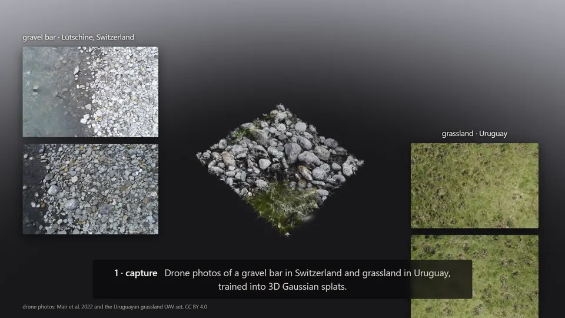
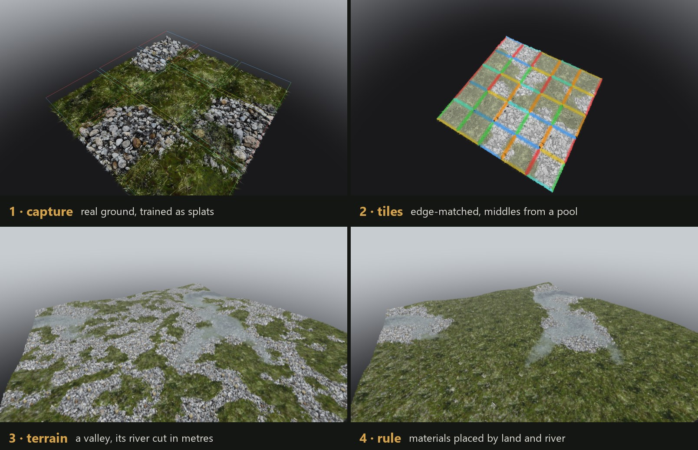
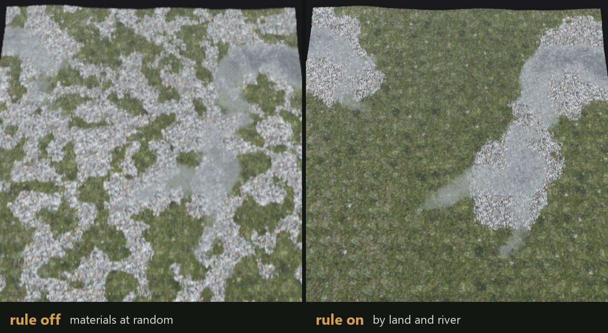
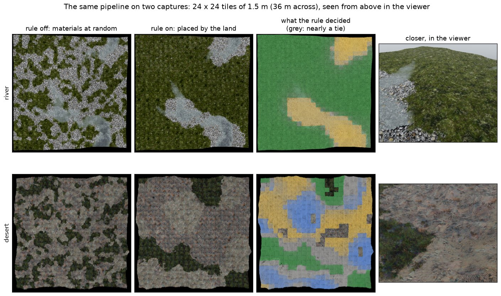
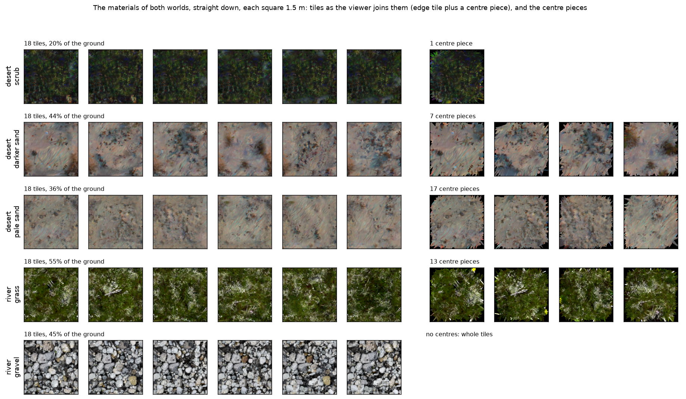
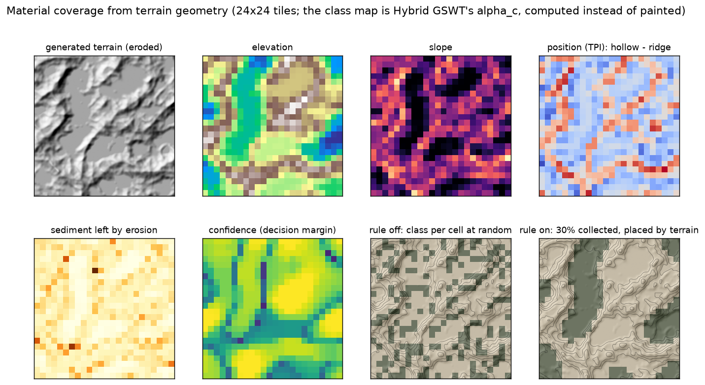

# bozkır

**Scan a few square metres of real ground. Get a whole world out of it, in
your browser.**



**[Live demo](https://husmen8.github.io/bozkir/?demo)** ·
[project page](https://husmen8.github.io/bozkir/project.html) ·
[full viewer](https://husmen8.github.io/bozkir/?scene=river) ·
[1-minute video](web/media/demo.mp4)

[](web/media/demo.mp4)

*Nine seconds from the [1-minute video](web/media/demo.mp4), recorded from
the viewer: a capture cut into tiles, gravel placed along the river, and the
rule's decision in the desert.*

Every pebble and blade of grass here comes from real drone photos, captured
as 3D Gaussian splats. bozkır turns that small scan into ground of any size
with no visible seams. It decides by itself where each kind of ground
belongs: gravel along the rivers, grass on the banks, scrub in the hollows.
Then it cuts rivers into the land and fills them with water taken from the
same photos.

No painting, no tiling grid, no game engine. It runs in a web page on a
laptop.



## What it does

1. **Captures real ground.** Drone photos become a 3D scan in metres.
2. **Makes it tile.** The scan is cut into tiles whose edges always match,
   and each tile's middle is swapped for a different piece of the same
   ground, so nothing repeats in a pattern.
3. **Lets the land decide.** A generated terrain (hills, valleys, erosion)
   says where each material goes: what collects in hollows and channels,
   what stays on ridges and slopes.
4. **Adds rivers.** Where the land drains, a river is carved into it, with
   real depth, bends and gravel bars. Its water is built from layers
   measured in the drone photos, so it looks like the river it came from.

## Why it is different

- **Real look.** Every surface is captured, not drawn or generated.
- **Placed, not painted.** Ten kilometres of world need no brush work: move
  a slider and the land redistributes the materials.
- **Repeatable.** A terrain profile and a seed always give the same world,
  on any machine.
- **Light.** A 20-30 MB tileset covers hundreds of metres of ground at
  about 30 fps on a laptop GPU, with no install and no third-party code.



*Same tiles, same valley. Left: materials at random. Right: placed by the
land and the river.*

## Try it

```bash
git clone https://github.com/husmen8/bozkir && cd bozkir
pip install -r requirements.txt          # Python 3.10+
python scripts/serve.py                  # then open http://localhost:8000
```

- `?demo`: the one-minute demo of both worlds, playing itself.
- `?scene=river`: the river world with every setting.
- No parameter: the desert.

To make a world from your own ground:

```bash
python scripts/build.py my_ground.ply --preset ground -o web/data/my_ground
```

`scripts/tools/groundsplat.py` turns drone photos or a video into that
`.ply`. [docs/usage.md](docs/usage.md) has the commands and every viewer
option. `python tests/run_all.py` runs the ~375 tests (the web suite needs
Node 22+).

## Two worlds ship with it

Same pipeline, two very different captures.

|                      | River                                              | Desert                                      |
|----------------------|----------------------------------------------------|---------------------------------------------|
| Ground from          | Lütschine gravel bar, Switzerland, and Uruguayan grassland | Coal Oil Point dunes, California (OpenDroneMap COPR) |
| Materials            | grass, gravel, and water from the same photos      | scrub, darker sand, pale sand               |
| Photo detail         | gravel about 1.6 mm per pixel, grass 3.6 mm        | 3.45 mm per pixel                           |
| Looks sharp from     | gravel about 1 m, grass about 2.5 m                | about 2.3 m                                 |
| Tiles                | 36 tiles, 13 centre pieces                         | 54 tiles, 25 centre pieces                  |
| Download             | 30 MB                                              | 19 MB                                       |
| Terrain              | generated valley, river cut in at 6 m wide         | generated, eroded desert hills              |



*Both worlds are 24 × 24 tiles (36 m across), seen from above in the viewer. With the
rule off, every tile takes a material at random. With it on, gravel follows the
river and the desert's materials follow its hollows and ridges. The third column shows the rule's choice
for each tile, grey where it was nearly a tie.*



*What each material is made of: tiles as the viewer joins them, and the
centre pieces it swaps into their middles so no tile repeats whole. Every
square is 1.5 m of real ground.*

## How the land decides



The rule reads what a geologist would look at: height, slope, whether a spot
is a hollow or a ridge, and where erosion left sediment. Each tile gets the
material that fits best, with grey where the margin is thin. In the river
world, water depth and the distance to the bank come first: gravel bars form
low beside the channel, grass climbs the banks.

## Good to know

- Light is baked into the scan, so there's no time of day or relighting.
  Overcast scans work best.
- A drone scan looks sharp from about a metre away. Walk closer and grass
  goes soft.
- The water is drawn, not simulated: no splashes or waves.

## Where it came from

The idea of tiling splat ground with Wang tiles comes from *Gaussian
Splatting Wang Tiles* (Zeng, Ma and Sander, SIGGRAPH Asia 2025). bozkır
started by rebuilding that, then added:

- the tile middles from a pool of the scan's own ground;
- measuring each scan (its materials, holes, haze);
- placing materials by terrain;
- rivers and their water;
- the scan training tools;
- most of the renderer.

How each step works, the measurements and the full list of limits are in
[docs/details.md](docs/details.md).

---

## Layout

```
bozkir/    the Python pipeline: ply, transform, select, scene, patches,
           tile, graphcut, cut, wang, materials, frames, pick, holes,
           decals, pack (+ atlas), presets, render, camera, popping;
           terrain and erosion (height fields, generator); landform (the
           viewer's rule); validate; catalogue
scripts/   command-line tools: build, export_wang, decals, bake_atlas,
           make_tileset, preview_patches, inspect_ply, terrain_gen,
           heightmap, validate_rule, repetition, water_texture, figures,
           side_by_side, serve, record_demo (the demo video), ...;
           experiments/ for one-offs; tools/ for finding, training and
           preparing captures (separate from the method, tools/README.md)
web/       the viewer: viewer, ui, style.css, shaders, gl, splat, camera,
           frames, decals, sort-worker, order, merge, grid, landform +
           rule.json (the rule and the river), terrain + terrain-worker,
           heightfield, tileset, starter, capture, benchmark, film (the
           demo); views.json
           (presets and stories), info.json (the ⓘ notes),
           tilesets.json; project.html, project.css and media/ (the project page, its
           figures, the demo's photos, its video and a short preview)
tests/     run_all.py: test_all.py (package), test_pipeline.py (pipeline,
           Python/JS parity, scripts end to end), test_web.mjs (browser
           modules); bridge.mjs runs the JavaScript for the parity tests
docs/      usage, viewer guide, terrain sources, figures
```

## Data and software

- Desert capture: OpenDroneMap's
  [COPR dataset](https://github.com/OpenDroneMap/odm_data_copr) (Michele M.
  Tobias and Alex Mandel, 2009), CC BY-SA 4.0. The tileset and its atlas in
  `web/data` are derived from it and shared under the same licence; the
  height field and sediment map are generated.
- River capture: gravel and water from the Lütschine L2 drone survey
  (Mair et al. 2022, [Zenodo 6415047](https://zenodo.org/records/6415047)), grass from the
  Uruguayan native grassland UAV images
  ([Zenodo 14771664](https://zenodo.org/records/14771664)), both
  [CC BY 4.0](https://creativecommons.org/licenses/by/4.0/). `web/data/river.*`
  and the water tiles (`web/data/water*.png`, made by
  `scripts/water_texture.py`) are derived from them; the river's terrain is
  generated and its channel cut in the viewer.
- `web/media/demo/`: nine of those drone photos, downsized, for the demo,
  under their datasets' licences.
- Python: NumPy, SciPy, plyfile, Pillow, Matplotlib.
- Viewer: WebGL2 and plain ES modules, no third-party code. Tilesets use
  antimatter15's `.splat` layout, so they open in other `.splat` viewers.

## References

Zeng, Ma, Sander. *Gaussian Splatting Wang Tiles.* SIGGRAPH Asia 2025.

Zeng, Ma, Sander. *Hybrid Gaussian Wang Tiles for Class-aware Authoring and
Rendering.* SIGGRAPH 2026.

Kerbl, Kopanas, Leimkühler, Drettakis. *3D Gaussian Splatting for Real-Time
Radiance Field Rendering.* SIGGRAPH 2023.

Kerbl, Meuleman, Kopanas, Wimmer, Lanvin, Drettakis. *A Hierarchical 3D
Gaussian Representation for Real-Time Rendering of Very Large Datasets.*
SIGGRAPH 2024.

Radl, Steiner, Parger, Weinrauch, Kerbl, Steinberger. *StopThePop: Sorted
Gaussian Splatting for View-Consistent Real-time Rendering.* SIGGRAPH 2024.

Cohen, Shade, Hiller, Deussen. *Wang Tiles for Image and Texture
Generation.* SIGGRAPH 2003.

Kwatra, Schödl, Essa, Turk, Bobick. *Graphcut Textures: Image and Video
Synthesis Using Graph Cuts.* SIGGRAPH 2003.

Lagae, Dutré. *An Alternative for Wang Tiles: Colored Edges versus Colored
Corners.* ACM TOG 2006.

Heitz, Neyret. *High-Performance By-Example Noise using a
Histogram-Preserving Blending Operator.* HPG 2018.

Mikkelsen. *Practical Real-Time Hex-Tiling.* JCGT 2022.

Mishkinis. *Advanced Terrain Texture Splatting.* Gamasutra 2013.

Glanville. *Texture Bombing.* GPU Gems, 2004.

Emilien, Vimont, Cani, Poulin, Benes. *WorldBrush: Interactive
Example-based Synthesis of Procedural Virtual Worlds.* SIGGRAPH 2015.

Weiss. *Topographic Position and Landforms Analysis.* ESRI User Conference,
2001.

Braun, Willett. *A very efficient O(n), implicit and parallel method to
solve the stream power equation governing fluvial incision and landscape
evolution.* Geomorphology 2013.

Cordonnier et al. *Large Scale Terrain Generation from Tectonic Uplift and
Fluvial Erosion.* Computer Graphics Forum (Eurographics) 2016.

Schott, Paris, Fournier, Guérin, Galin. *Large-scale Terrain Authoring
through Interactive Erosion Simulation.* ACM TOG 2023.

Leopold, Maddock. *The Hydraulic Geometry of Stream Channels and Some
Physiographic Implications.* USGS Professional Paper 252, 1953.

Leopold, Wolman. *River Meanders.* GSA Bulletin 1960.

Keller, Melhorn. *Rhythmic Spacing and Origin of Pools and Riffles.* GSA
Bulletin 1978.

Church. *Bed Material Transport and the Morphology of Alluvial River
Channels.* Annual Review of Earth and Planetary Sciences 2006.

Vlachos. *Water Flow in Portal 2.* SIGGRAPH 2010 Advances in Real-Time
Rendering course.

Mair, Do Prado, Garefalakis, Lechmann, Whittaker, Schlunegger. *Grain size
of fluvial gravel bars from close-range UAV imagery.* Earth Surface
Dynamics 2022.

Barnes, Lehman, Mulla. *Priority-Flood: An optimal depression-filling and
watershed-labeling algorithm for digital elevation models.* Computers &
Geosciences 2014.
