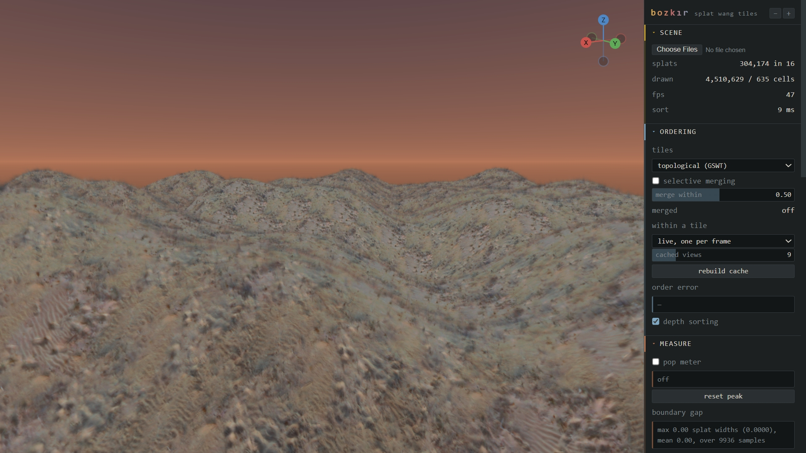
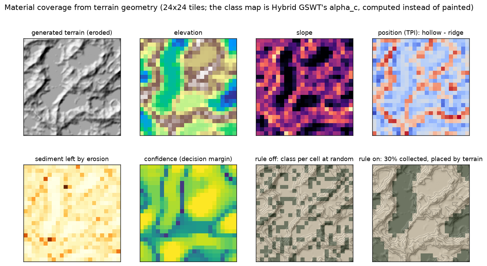
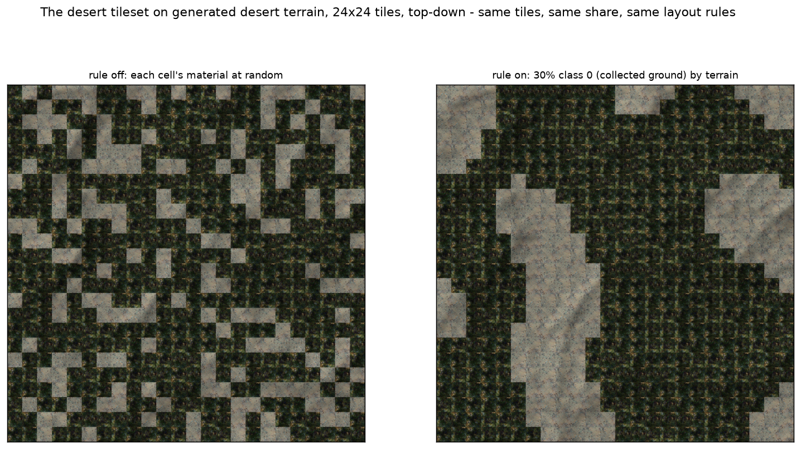
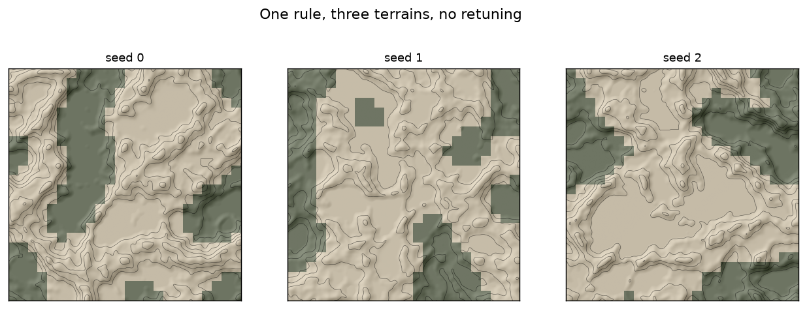
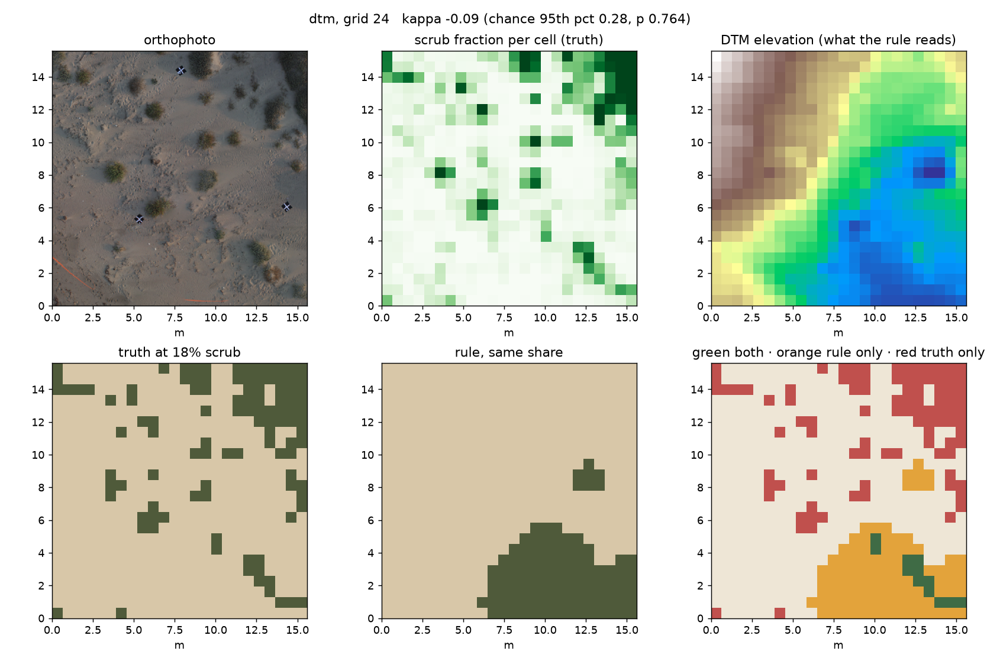
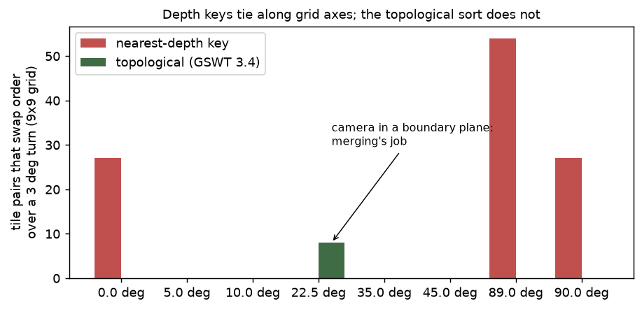
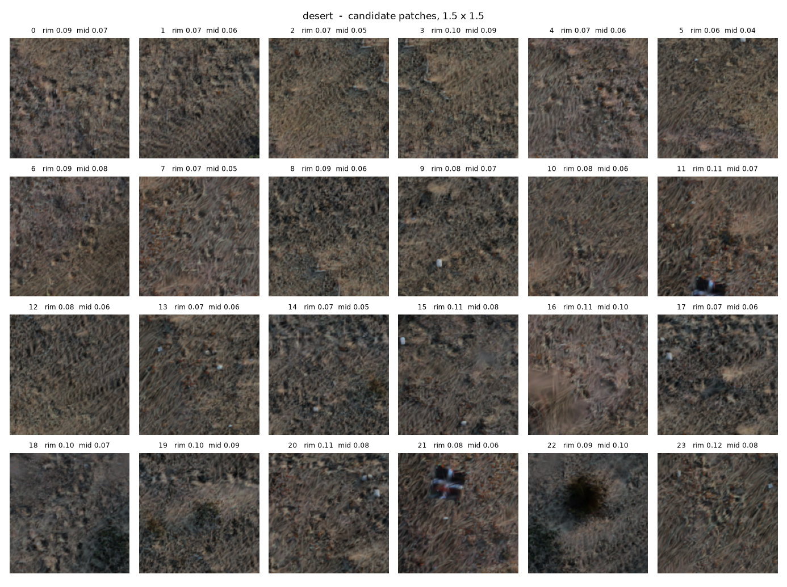
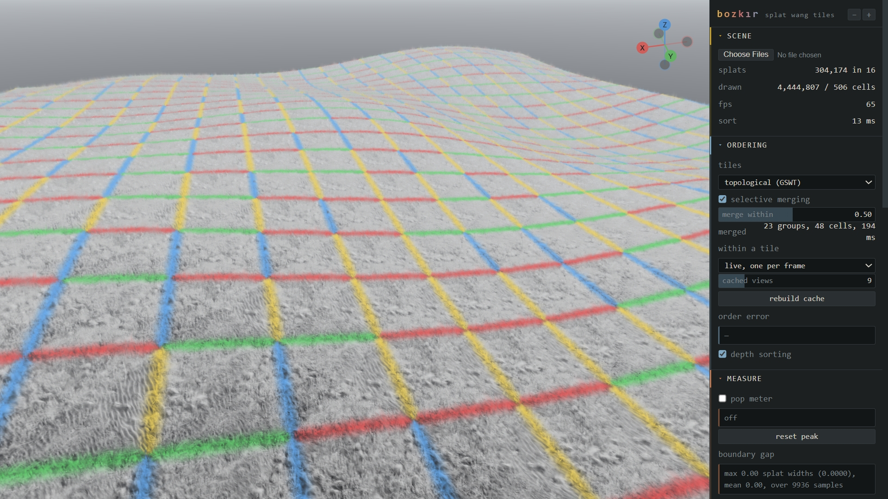
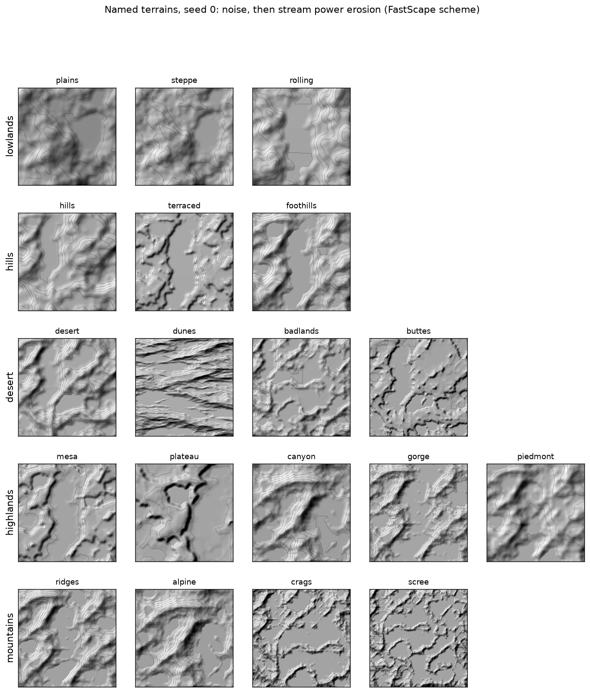

# bozkır

Kilometres of terrain from a few square metres of captured Gaussian-splat
ground, with materials placed by the shape of the land.

A capture of real ground is cut into Wang tiles whose edges match, and laid
over procedural terrain with no visible seam. That part reimplements
*Gaussian Splatting Wang Tiles* (Zeng, Ma and Sander, SIGGRAPH Asia 2025).
**What is new is where each material goes.**

**Live demo: [husmen8.github.io/bozkir](https://husmen8.github.io/bozkir/)** -
the desert tileset on its terrain, in the browser (WebGL2).
[`?scene=starter`](https://husmen8.github.io/bozkir/?scene=starter) is a
two-material tileset made in the page, with no data at all.

<!-- hero: a screenshot of the live demo in figure mode (F, then P) -->


*The desert tiles are made from OpenDroneMap's
[COPR dataset](https://github.com/OpenDroneMap/odm_data_copr) (Coal Oil
Point Reserve, California; Michele M. Tobias and Alex Mandel, 2009),
licensed [CC BY-SA 4.0](https://creativecommons.org/licenses/by-sa/4.0/).
I trained the splats and cut the tiles; the tileset in `web/data` is shared
under the same licence.*

**What it is for.** Ground under a fixed light: game levels with a set time
of day, previs, architectural visualisation, simulation grounds - real
surfaces over large procedural terrain, materials where the land says they
go.

**What it is not for.** Anything that must be relit or have a day cycle
(lighting is baked into a capture), cliffs and walls, trees and tall
objects as tiles, water, and captures with too little clean flat ground -
roughly four tile-sized areas of each material.

## Install and run

```bash
git clone https://github.com/husmen8/bozkir && cd bozkir
pip install -r requirements.txt          # Python 3.10+
python tests/run_all.py                  # ~300 tests; the web suite needs Node 22+
cd web && python -m http.server 8000     # then open http://localhost:8000
```

From a capture of your own ground: `python scripts/make_tileset.py my_ground.ply`
ends with a verdict and the address to open. [docs/usage.md](docs/usage.md)
covers the full pipeline, terrain generation and the viewer's options;
[docs/viewer-guide.md](docs/viewer-guide.md) explains every control (the
same text as the viewer's ⓘ notes).

---

## The contribution: material coverage computed from terrain

*Hybrid Gaussian Wang Tiles* (SIGGRAPH 2026) picks a material class at each
world position with

```
P̃_c(x, u) = P_c(u) ^ (1 / α_c(x)),    c* = argmax_c P̃_c(x, u)
```

where α_c(x) is a target coverage per class. In their authoring system it
comes from a **class map that a person paints with a brush**, beside a
separately painted height map - the two are independent. Nobody paints a
ten-kilometre map, and terrain shaders in every engine already place
material by slope and height.

bozkır derives the class decision from the height field instead: slope, topographic position
(TPI, Weiss 2001), drainage, altitude, and on generated terrain the
erosion's own sediment record. Their equation takes it unchanged.



The same decision rendered from the real tiles, seen from above with the
terrain as shading; only where each class goes differs between the panels:



The maps are sampled at 4× the tile grid (one sample per tile aliases), and
drainage is max-pooled so a channel narrower than a tile survives. The
class-lead field goes through a median filter (regions become contiguous
without the boundary moving) and a rank threshold, so the share asked for
is the share given. The weights live in one file, `web/rule.json`, read by
the viewer and by `bozkir/landform.py`; the tests hold the two identical
cell for cell.



The same rule and settings on three terrains: it is a rule, not a
placement. The share is an artist's control; the terrain decides where it
goes.

**What this can and cannot claim.** Finding tiles, splitting a capture into
classes, the terrain analysis and the rule work for any input. The mapping
from landform to material - collected material in hollows, bare ground on
ridges - is a judgement: defensible for sand and scrub in arid ground, wrong
for moss on shaded rock. The claim is *a framework for geometry-driven
material placement*: a planner that an artist steers, not a map of where
materials really grow. Testing the judgement against real ground is below;
learning the mapping from data is the open question.

---

## Results

### 1. The rule against a real survey: null, and why it could not decide

`scripts/validate_rule.py` lines an OpenDroneMap DTM and orthophoto up on
the viewer's cell grid, runs the viewer's own rule on the DTM, and scores it
against where scrub actually grows. The rule is given the true share, so it
is judged only on *where*. Chance is measured by shifting the truth around a
torus at every offset (clumpy maps overlap by chance). The hypothesis - in
arid ground scrub grows where water collects - is stated first, with the
flipped mapping reported beside it. Truth comes from colour and,
independently, from vegetation height (DSM − DTM).

On the one survey available - the 15.6 m COPR plot - the rule never beats
chance, at any grid, against either truth, and neither does its flip:

| grid | truth | scrub share | κ rule | κ flipped | chance κ (95th pct.) | p (rule) |
|---|---|---|---|---|---|---|
| 16 | colour | 18% | −0.07 | −0.10 | 0.35 | 0.61 |
| 24 | colour | 18% | −0.09 | −0.09 | 0.28 | 0.76 |
| 32 | colour | 18% | −0.13 | −0.06 | 0.24 | 0.91 |
| 16 | height | 3% | −0.04 | −0.04 | 0.08 | 1.00 |
| 24 | height | 3% | −0.03 | −0.03 | 0.13 | 1.00 |
| 32 | height | 3% | −0.03 | −0.03 | 0.09 | 1.00 |



- *Facts.* The plot is one slope - a single tilted plane explains 86% of its
  height - with few hollows or ridges to tell apart. The two truths disagree
  (18% scrub by colour, 3% by height). About 42 comparisons were made, so
  the single p = 0.014 among them is what chance produces.
- *Inferences, testable with this data.* A low sun makes shadows read as
  scrub and inflates the colour truth; ODM's DTM kept some bushes as ground.
- *What needs new data.* A survey spanning several landforms, 100 m or
  more, captured overcast.

The script prints these caveats itself. No mapping is fitted to this plot -
with one slope it would learn noise. On ground with almost no hollows or
ridges, any landform rule scores near chance, so this result says the plot
could not separate the rule from chance, not that the rule is wrong. It is
the motivation for the open question, learning placement from data:

- *from the capture itself* - measure where each material sits in the
  captured ground and carry those statistics to the large terrain, as
  WorldBrush (Emilien et al. 2015) learns distributions from example areas;
- *from public elevation and aerial imagery* over several landforms, with
  sites and metric fixed before scoring;
- *from people* - a small study of whether rule-on reads as more natural
  than rule-off, the same study the busyness result below asks for.

### 2. Repetition, and what the eye sees

Each tile is four triangles, one per edge, each always the same part of the
patch for that edge's colour (Cohen et al. 2003). Anything distinctive in a
patch therefore sits at the same place in every tile built from it and
forms a lattice. Against that: more colours (`--colours 3`, with Cohen's
minimal set of two tiles per (west, south) pair - 18 per class instead of
81), patches turned by 90° as extra colours (`--rotations`; turning a
finished tile would break matching, turning a patch does not), landmarks
scored down in the patch search, and purity (each class keeps the patches
with the least of the other material).

`scripts/repetition.py` measures repetition as excess similarity at
whole-tile shifts over half-tile shifts, on brightness ("texture") and on a
map of what stands out ("landmarks"). On the desert tileset, lower is less
repetition:

| setting | sand texture | scrub texture | sand landmarks | scrub landmarks | my judgement |
|---|---|---|---|---|---|
| 2 colours, straight seams | 0.502 | 0.413 | 0.479 | 0.381 | - |
| 3 colours, straight | 0.335 | 0.396 | 0.304 | 0.244 | - |
| 3 colours, graph cut | 0.317 | 0.380 | - | - | - |
| 3 colours, 2 sources × 3 turns (`desert3`) | 0.314 | 0.353 | 0.280 | 0.307 | **best** |
| 3 colours, 3 sources × 2 turns | 0.334 | 0.276 | 0.284 | 0.259 | worst |
| 4 colours, 4 sources × 2 turns (`desert2`) | 0.270 | 0.225 | 0.211 | 0.180 | second |

More colours cut sand repetition by a third; graph cut matters more to the
eye (a visible X) than to the metric. **Neither repetition metric agrees
with what I saw**: the run I judged best is not the one that repeats least.
Looking at them, I was trading repetition against *busyness* - how
different a tile's four triangles are - and preferring calm ground.

Busyness is measurable: the share of a tile's brightness variance explained
by which triangle a pixel is in (0 = one ground, 1 = four flat blocks). On
the two runs that still exist:

| setting | sand busyness | scrub busyness | my judgement |
|---|---|---|---|
| `desert3` | 0.083 ± 0.050 | 0.092 ± 0.044 | best |
| `desert2` | 0.070 ± 0.060 | **0.336 ± 0.136** | second |

`desert2` repeats least but its scrub tiles are 3.6 times busier, which is
what I objected to. Two runs agree with the eye; two runs are not a proof.
Perceived quality of tiled ground looks at least two-dimensional, and a
small perceptual study is the proper test.

### 3. Reimplementation

These reproduce and measure GSWT's own methods. They are not the
contribution, but they are what makes the terrain render correctly.

**Ordering tiles by depth is degenerate at axis-aligned views.** The
nearest projected depth ties for every cell in a row when the view lines up
with a grid axis - 81 cells collapse to 9 keys - and turning through
alignment reverses a whole row in one frame. GSWT's topological sort over
shared-edge constraints removes it (`scripts/probe_order.py`). The 8 at
22.5° are a boundary plane the camera really crosses, where selective
merging takes over.



**Selective merging** matches an exact world-space sort to under one bucket
of the 16-bit counting sort. A counting sort over the union beats a k-way
merge: 3.8 vs 9.5 ms at 300k splats, 25.6 vs 76.8 ms at 1.2M.

**On warped terrain, one sorted order per tile is not enough**: 47% of
adjacent pairs come out wrong. Sorting along the view direction in the
tile's own frame gives zero. That frame must be the true Jacobian -
normalising it thins material on slopes by exactly `sqrt(1+|∇h|²)`.

**Scaling** (GTX 1650 Ti): 60 fps to grid 40 (1,600 tiles, 5.5M splats),
30 fps at 48; draw calls are the ceiling (906 at grid 48), not splat count.
With the far field and auto quality, grid 256 × 256 (about 380 m of
ground) stays above 30 fps.

**Erosion.** Stream power carves where droplet erosion only smoothed:
channel network 11.7% → 33.9% of cells, height-drainage correlation
−0.29 → −0.46, and about 100× faster.

**Popping** is not yet measured well: `bozkir/popping.py` undoes camera
motion by phase correlation and block matching (StopThePop uses RAFT and
FLIP), and block matching is integer-accurate - a one-pixel registration
error on splat terrain is larger than the ordering effect. The ordering
result above does not depend on it.

---

## How it works

**Capture to tiles.** Align the capture to its ground plane, remove floaters
and background, then search for squares flat, dense and alike enough to
interchange. The search loosens whichever filter rejects most and reports
what it changed; a capture that cannot work at any setting says so.



Patches are recombined until each tile edge carries one of a few codes,
with a min-cut seam (`bozkir/graphcut.py`) placing each join where the two
patches already agree. Classes share edge codes - each code tuple exists
once per class - so a cell can take any class without consulting its
neighbours, and the matching constraint never overrules the terrain.



Not every capture can become tiles. `scripts/inspect_ply.py` and
`make_tileset.py`'s verdict screen them; of the captures I tried, one is
used. A sea stack is not ground (its splats are needles: median anisotropy
484), an aerial survey shot around a subject yields one usable region
rather than four, and a synthetic scan has no material to preserve. The
table is in [docs/captures.md](docs/captures.md).

**Terrain.** Fractal noise from an integer hash, Priority-Flood depression
filling, and stream-power erosion solved the FastScape way (Braun and
Willett 2013), with a sediment record the rule can read. Nineteen profiles
in five groups. The Python and JavaScript generators are held to the same
output bit for bit, so a profile and a seed name the same ground anywhere.
Height fields can also come from a drone DSM or from the capture itself;
[docs/terrain.md](docs/terrain.md) maps each step to its source.



**Renderer.** WebGL2: per-tile counting sort in a worker, Wang layout,
topological tile order, selective merging, warping onto the height field,
LOD with cross-fade, per-splat blending between classes. Beyond that:

- **Far field.** Past the splat levels of detail the ground is one mesh
  textured from an atlas of every tile seen from above
  (`scripts/bake_atlas.py`), with the same layout and rule - one draw call
  for all distant cells. Chosen over hierarchical 3DGS (Kerbl et al. 2024)
  because the limit here is draw calls, not splat count. Opaque, colour
  matched per tile to the splats, detail fading to the tile mean with
  distance, handed over by a dithered screen door.
- **Auto quality.** About 30 fps the way games do it: render resolution
  first (50-100%), level-of-detail distance only as a slow second lever -
  moving both at once made them chase each other between 20 and 45 fps.
- **Detail relief.** Ridged noise at tile scale, identical in the splats,
  the far field and the camera, masked to steep slopes and convex crests.
- **Ground shading** only darkens where the terrain would (a hollow sees
  less sky), since the capture cannot be relit.
- **Starter scene**: a two-material Wang set made in the page when no data
  loads, or with `?scene=starter`.

---

## The usual objections to splats in games

Practitioners' objections are consistent: no collision, large files,
visible seams where big scenes are split, content that cannot be edited, no
relighting. Where bozkır stands on each:

| objection | bozkır's answer | what remains |
|---|---|---|
| no collision | the ground is a height field, so the collider is the terrain itself - the "render the splats, collide with a hidden mesh" pattern engine users recommend | the tiles' own micro-relief is not in the collider |
| huge files | a kilometre-scale world from a 21.8 MB tileset (36 tiles) | the source capture is still large |
| seams when splitting big scenes | Wang tiles are seamless by construction; the far field hands over by dithering | a faint colour step at the hand-over |
| cannot be edited | layout, materials and terrain are procedural: rules, presets and sliders | the captured micro-geometry itself is not editable |
| no relighting | not solved: lighting is baked, ground shading only darkens | a sunny capture repeats its shadows |

Against generative world models (text-to-world, diffusion terrain) bozkır
does not compete on variety. It is *capture-driven procedural*: real
captured appearance, deterministic (a seed regenerates the same world bit
for bit), controllable by rule, and cheap - it runs in a browser on a laptop
GPU with no training.

---

## Limitations

- Lighting is baked into the capture: no relighting, no time of day.
  Shadows in a sunny capture become part of the repeating pattern; overcast
  captures tile better.
- The desert's scrub is only about 4 × 5 m of capture, so its patches
  overlap and repeat more than the sand.
- Class choice is per cell; without blending the boundary reads as
  rectangles (Hybrid GSWT's per-Gaussian priority avoids this).
- `.splat` keeps degree-0 colour only, so view-dependent colour is lost on
  export (mean error 14 on 0-255).
- The far field cannot follow splat size, loses per-splat blending, and a
  top-down atlas differs from grazing views: a faint colour step remains at
  the hand-over.
- Closed basins become flat floors ([docs/terrain.md](docs/terrain.md)).
- Features crossing a tile corner still repeat; corner tiles (Lagae and
  Dutré 2006) are the known fix.
- The upside-down check is one-way: a warning means something, silence
  proves nothing.
- Sorting and draw-call issue stay on the CPU.
- The rule's only validation is inconclusive: the one survey is a single
  slope (Results 1).

---

## Layout

```
bozkir/    the Python pipeline: ply, transform, select, scene, patches,
           tile, graphcut, wang, pack (+ atlas), presets, render, camera,
           popping; terrain and erosion (height fields, generator);
           landform (the viewer's rule); validate; catalogue
scripts/   command-line tools: make_tileset, export_wang, bake_atlas,
           preview_patches, inspect_ply, terrain_gen, heightmap,
           validate_rule, repetition, figures, ...; experiments/ for one-offs
web/       the viewer: viewer, ui, sort-worker, order, merge, grid,
           landform + rule.json, terrain + terrain-worker, heightfield,
           tileset, starter, capture, benchmark; views.json (presets and
           story), info.json (the ⓘ notes), tilesets.json
tests/     run_all.py: test_all.py (package), test_pipeline.py (pipeline,
           Python/JS parity, scripts end to end), test_web.mjs (browser
           modules); bridge.mjs runs the JavaScript for the parity tests
docs/      usage, viewer guide, terrain sources, capture screening, figures
```

## References

Zeng, Ma, Sander. *Gaussian Splatting Wang Tiles.* SIGGRAPH Asia 2025.

Zeng, Ma, Sander. *Hybrid Gaussian Wang Tiles for Class-aware Authoring and
Rendering.* SIGGRAPH 2026.

Kerbl, Kopanas, Leimkühler, Drettakis. *3D Gaussian Splatting for Real-Time
Radiance Field Rendering.* SIGGRAPH 2023.

Kerbl, Meuleman, Kopanas, Wimmer, Lanvin, Drettakis. *A Hierarchical 3D
Gaussian Representation for Real-Time Rendering of Very Large Datasets.*
SIGGRAPH 2024.

Radl, Steiner, Parger, Weinrauch, Kerbl, Steinberger. *StopThePop: Sorted
Gaussian Splatting for View-Consistent Real-time Rendering.* SIGGRAPH 2024.

Cohen, Shade, Hiller, Deussen. *Wang Tiles for Image and Texture
Generation.* SIGGRAPH 2003.

Emilien, Vimont, Cani, Poulin, Benes. *WorldBrush: Interactive
Example-based Synthesis of Procedural Virtual Worlds.* SIGGRAPH 2015.

Kwatra, Schödl, Essa, Turk, Bobick. *Graphcut Textures: Image and Video
Synthesis Using Graph Cuts.* SIGGRAPH 2003.

Lagae, Dutré. *An Alternative for Wang Tiles: Colored Edges versus Colored
Corners.* ACM TOG 2006.

Weiss. *Topographic Position and Landforms Analysis.* ESRI User Conference,
2001.

Braun, Willett. *A very efficient O(n), implicit and parallel method to
solve the stream power equation governing fluvial incision and landscape
evolution.* Geomorphology 2013.

Cordonnier et al. *Large Scale Terrain Generation from Tectonic Uplift and
Fluvial Erosion.* Computer Graphics Forum (Eurographics) 2016.

Schott, Paris, Fournier, Guérin, Galin. *Large-scale Terrain Authoring
through Interactive Erosion Simulation.* ACM TOG 2023.

Barnes, Lehman, Mulla. *Priority-Flood: An optimal depression-filling and
watershed-labeling algorithm for digital elevation models.* Computers &
Geosciences 2014.
