# bozkır in detail

The method step by step, the measurements behind it and its limits. The
[README](../README.md) is the short version; [usage.md](usage.md) covers
the commands and the viewer's options.

## How each step works

### Capture: real ground, trained in metres

Drone photos (or a walk-around video) go through
`scripts/tools/groundsplat.py`: COLMAP poses, a block of ground cut out
where enough photos see it, gsplat training, then the ground found from
below, levelled and set in metres. What a capture can show is decided when
it is taken. Ground photographed at 3-4 mm per pixel holds up from about a
metre away and no closer. Grass that moves in the wind between photos stays
soft however long it trains, and more splats only add slivers that read as
needles up close.

### Tiles: frames and a pool of centres

The export aligns the capture to its ground, removes floaters, finds its
materials and searches each for squares flat, dense and alike enough to
interchange. Every candidate is checked for see-through holes and haze, and
each decision is printed with its reason. Patches become Wang tiles (Cohen
et al. 2003) joined by min-cut seams, with edge codes shared by every
material, so a cell can take any material without consulting its
neighbours.

A tile keeps only a frame along its edges, which is what neighbours must
agree on. Each cell's middle is a centre drawn and turned in the viewer from
a per-material pool cut from the capture's own ground (random placement and
rotation hide a texture's period; Heitz and Neyret 2018), so no tile repeats
whole. How a material may turn is measured from its patches: ripples and
rows keep their direction, isotropic ground turns in quarter turns.

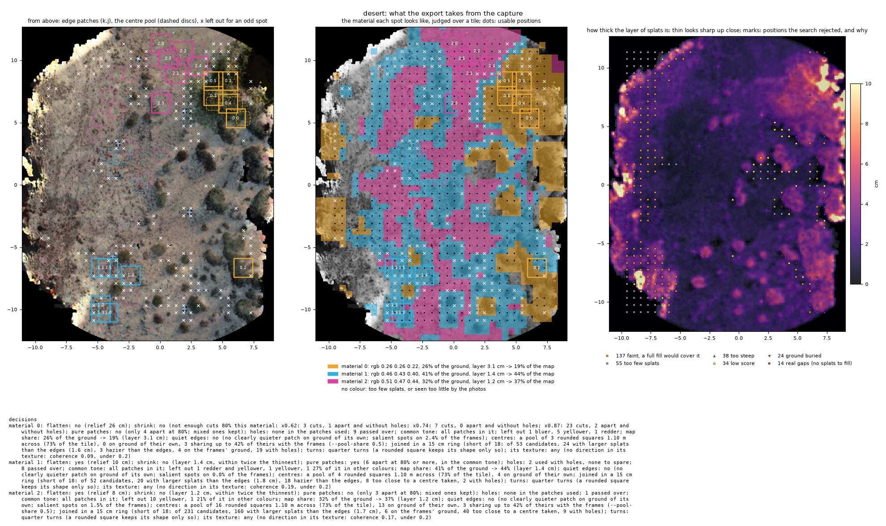

*Left: edge patches and the centre pool on the capture. Middle: the
material each spot resembles. Right: splat-layer thickness and the
positions the search rejected, with the reason. Below: every decision,
per material, as `build.py --look` prints it.*

### Materials placed by the land

Terrain is generated and eroded in the browser and in Python, bit for bit
alike: fractal noise, Priority-Flood depression filling, stream-power
erosion solved implicitly (Braun and Willett 2013), with a sediment record.
Each material then goes where the land says: the one that collects into
hollows and channels, the exposed one onto steep, convex ground. The rule
reads slope, topographic position (TPI, Weiss 2001), drainage, altitude and
the erosion's sediment. Class-aware splat tiling takes this coverage from a
map painted by hand; here it is computed, so a ten-kilometre world needs no
painting.

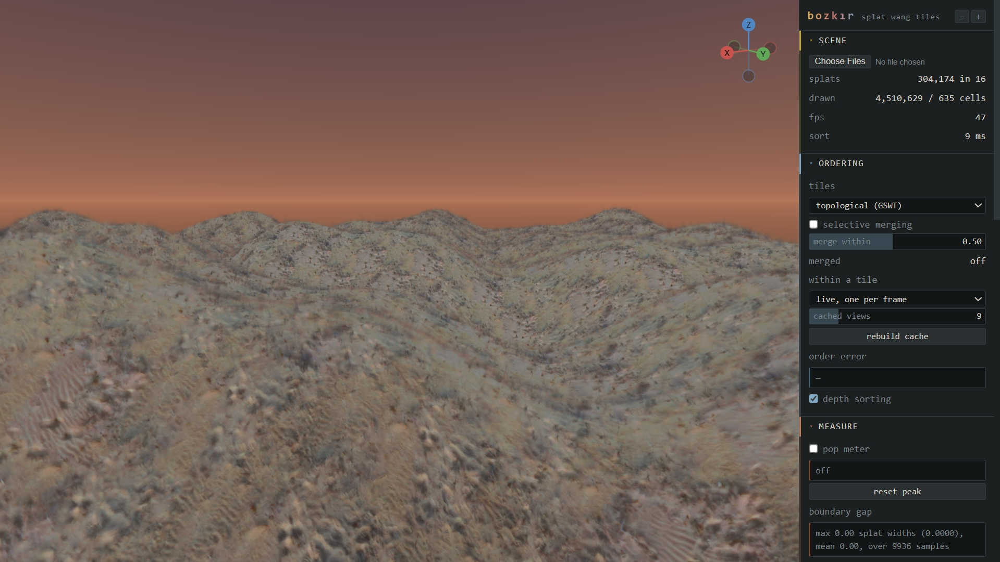

*The desert tileset, the live page's default: sand and scrub from the COPR
survey over its generated terrain, each placed by the rule.*

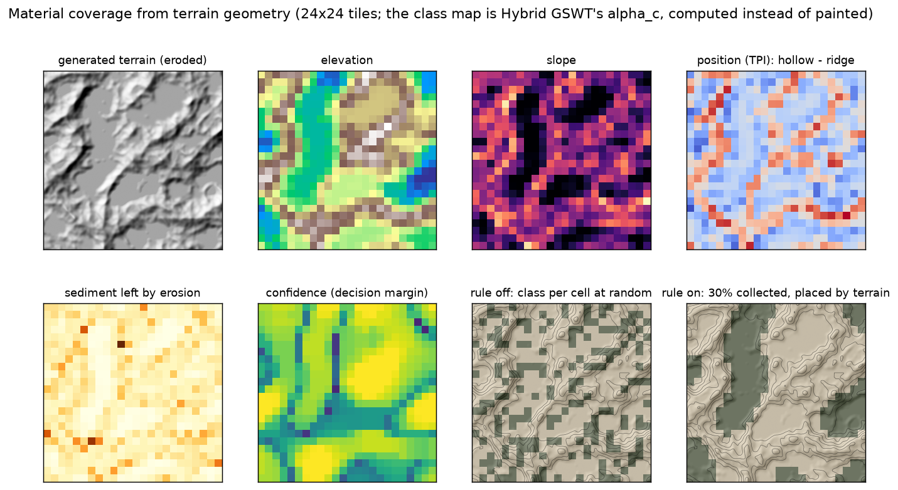

The same decision rendered from the desert's shipped tiles and centres,
three materials at the capture's own shares, seen from above with the
terrain as shading; only where each material goes differs:

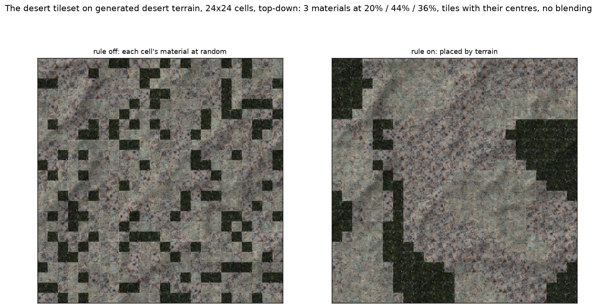

The maps are sampled at 4× the tile grid, and drainage is max-pooled so a
channel narrower than a tile survives. A median filter makes regions
without moving their boundaries, and a rank threshold gives each material
exactly its share. With three or more materials the height at which one
gives way to the next wanders by fractal noise, by an amount measured from
the capture (how often its materials are out of height order, Mann-Whitney
U). The weights live in one file, `web/rule.json`, read by the viewer and by
`bozkir/landform.py`; the tests hold the two identical cell for cell.

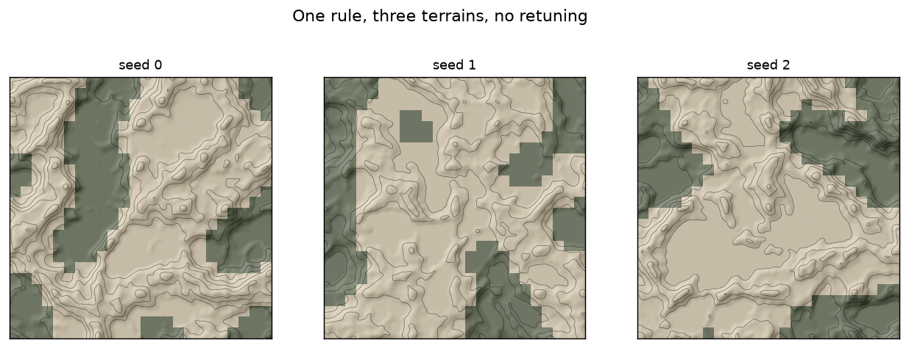

**Scope of the claim.** Finding tiles, splitting a capture into classes,
the terrain analysis and the rule work for any input. The mapping from
landform to material is a judgement: defensible for sand and scrub in arid
ground, wrong for moss on shaded rock. It is a planner an artist steers,
not a map of where materials really grow; a test against real ground is
under Results.

### Rivers and water

**Course and channel.** The terrain's largest drainage systems become
rivers, smoothed and meandered, with their width in metres. Branches are
narrower, since width grows with the square root of the area drained
(Leopold and Maddock 1953). The channel is cut into the ground:

- a bed a twentieth as deep as it is wide (at most 0.6 m);
- its deepest line towards the outside of bends, a cut bank there and a
  gentle point bar inside;
- pools and riffles about six widths apart;
- banks rising gently until they meet the ground.

**Water.** A level surface that never rises downstream and stays inside the
channel. Each point under it is drawn on that surface and coloured by its
own depth. The bed shows through by a share measured from the fading stone
contrast in 29 drone photos of the Lütschine, under the milky shallow water
near the banks and the dark channel water further out, both photographed.
Stones above the level stay dry, so the waterline follows them. With flow
on, the ripples move along the river, faster where it is deeper; the
photo's broad pattern stays where it lies.

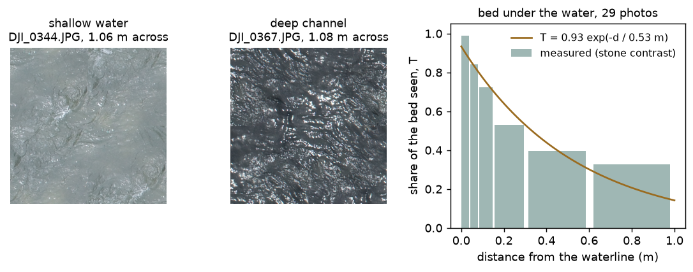

**Gravel where a river leaves it.** Along a river drawn as water, the bar
material goes low beside the channel (within about a channel depth above
the water) and within reach of it (about half a river width). That makes
bars wide on flat floors and thin under steep banks, broken up along the
river by noise. Its share follows the river and the valley, not the
capture.

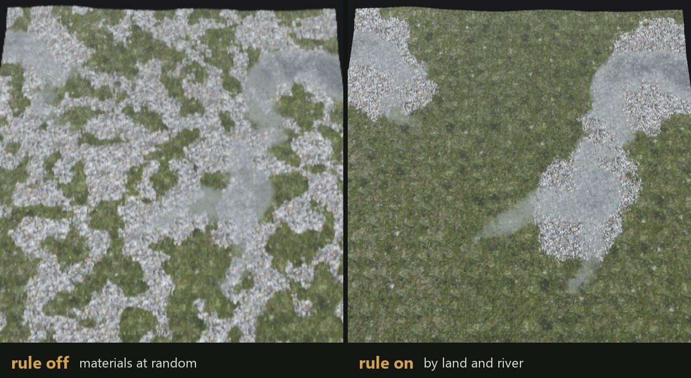

### In the browser

WebGL2 and plain ES modules:

- splats sorted per tile in a worker, and tiles ordered by their shared-edge
  constraints;
- each splat bent over the terrain through the height field's true Jacobian;
- levels of detail, and a far field that hands distant ground to one mesh
  textured from an atlas of the tiles;
- auto quality holding about 30 fps.

A world of 256 × 256 tiles (about 380 m of ground) stays above 30 fps on a
laptop GPU.

## Results

### 1. The rule against a real survey: null, and why it could not decide

`scripts/validate_rule.py` lines an OpenDroneMap DTM and orthophoto up on
the viewer's cell grid, runs the viewer's own rule on the DTM, and scores it
against where scrub actually grows. The rule is given the true share, so it
is judged only on *where*. Chance is measured by shifting the truth around a
torus at every offset (clumpy maps overlap by chance). The hypothesis - in
arid ground scrub grows where water collects - is stated first, with the
flipped mapping reported beside it. Truth comes from colour and,
independently, from vegetation height (DSM − DTM).

On the one survey available - the 15.6 m COPR plot - the rule never beats
chance, at any grid, against either truth, and neither does its flip:

| grid | truth | scrub share | κ rule | κ flipped | chance κ (95th pct.) | p (rule) |
|---|---|---|---|---|---|---|
| 16 | colour | 18% | −0.07 | −0.10 | 0.35 | 0.61 |
| 24 | colour | 18% | −0.09 | −0.09 | 0.28 | 0.76 |
| 32 | colour | 18% | −0.13 | −0.06 | 0.24 | 0.91 |
| 16 | height | 3% | −0.04 | −0.04 | 0.08 | 1.00 |
| 24 | height | 3% | −0.03 | −0.03 | 0.13 | 1.00 |
| 32 | height | 3% | −0.03 | −0.03 | 0.09 | 1.00 |

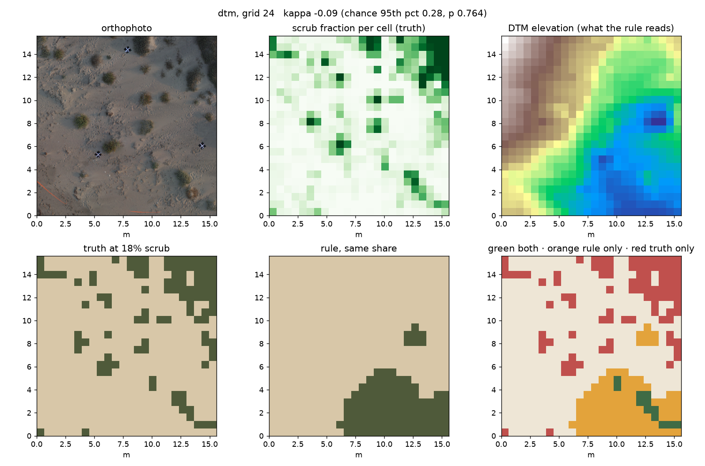

- *Facts.* The plot is one slope - a single tilted plane explains 86% of its
  height - with few hollows or ridges to tell apart. The two truths disagree
  (18% scrub by colour, 3% by height). About 42 comparisons were made, so
  the single p = 0.014 among them is what chance produces.
- *Inferences, testable with this data.* A low sun makes shadows read as
  scrub and inflates the colour truth; ODM's DTM kept some bushes as ground.
- *What needs new data.* A survey spanning several landforms, 100 m or
  more, captured overcast.

The script prints these caveats itself. No mapping is fitted to this plot -
with one slope it would learn noise. On ground with almost no hollows or
ridges, any landform rule scores near chance, so this result says the plot
could not separate the rule from chance, not that the rule is wrong. It is
the motivation for the open question, learning placement from data:

- *from the capture itself* - measure where each material sits in the
  captured ground and carry those statistics to the large terrain, as
  WorldBrush (Emilien et al. 2015) learns distributions from example areas;
  the measured height order above is a first step;
- *from public elevation and aerial imagery* over several landforms, with
  sites and metric fixed before scoring;
- *from people* - a small study of whether rule-on reads as more natural
  than rule-off, the same study the busyness result below asks for.

### 2. Repetition, and what the eye sees

Each tile is four triangles, one per edge; the triangle on an edge comes
from a patch of that edge's colour, centred on the edge (Cohen et al. 2003).
Anything distinctive in a patch therefore sits at the same place in every
tile built from it and forms a lattice. Against that: more colours
(`--colours 3`, with Cohen's minimal set of two tiles per (west, south)
pair - 18 per class instead of 81), patches turned by 90° as extra colours
(`--rotations`; turning a finished tile would break matching, turning a
patch does not), landmarks scored down in the patch search, and purity
(each class keeps the patches with the least of the other material).

`scripts/repetition.py` measures repetition as excess similarity at
whole-tile shifts over half-tile shifts, on brightness ("texture") and on a
map of what stands out ("landmarks"). On an earlier two-material export of
the desert (sand, scrub), lower is less repetition:

| setting | sand texture | scrub texture | sand landmarks | scrub landmarks | visual rank |
|---|---|---|---|---|---|
| 2 colours, straight seams | 0.502 | 0.413 | 0.479 | 0.381 | - |
| 3 colours, straight | 0.335 | 0.396 | 0.304 | 0.244 | - |
| 3 colours, graph cut | 0.317 | 0.380 | - | - | - |
| 3 colours, 2 sources × 3 turns | 0.314 | 0.353 | 0.280 | 0.307 | 1 |
| 3 colours, 3 sources × 2 turns | 0.334 | 0.276 | 0.284 | 0.259 | 3 |
| 4 colours, 4 sources × 2 turns | 0.270 | 0.225 | 0.211 | 0.180 | 2 |

More colours cut sand repetition by a third; graph cut matters more to the
eye (a visible X) than to the metric. **Neither repetition metric agrees
with the visual ranking**: the run ranked first is not the one that repeats
least. The ranking traded repetition against *busyness* - how different a
tile's four triangles are - in favour of calm ground.

Busyness is the share of a tile's brightness variance explained by which
triangle a pixel is in (0 = one ground, 1 = four flat blocks). On the two
runs that still exist:

| setting | sand busyness | scrub busyness | visual rank |
|---|---|---|---|
| 3 colours, 2 sources × 3 turns | 0.083 ± 0.050 | 0.092 ± 0.044 | 1 |
| 4 colours, 4 sources × 2 turns | 0.070 ± 0.060 | **0.336 ± 0.136** | 2 |

The 4-colour run repeats least but its scrub tiles are 3.6 times busier.
Two runs agree with the eye; two runs are not a proof. Perceived quality of
tiled ground looks at least two-dimensional, and a small perceptual study
is the proper test.

The shipped tileset goes further: each cell's centre comes from a separate
per-material pool, chosen and turned in the viewer (*Frames and centres*
below), so the lattice is left only in the band along the edges.
`repetition.py` lays out exported tiles and does not model the centres
yet, so it has no figure for the shipped tileset.

### 3. Rendering

What makes tiles on terrain render correctly, measured.

**Ordering tiles by depth is degenerate at axis-aligned views.** The
nearest projected depth ties for every cell in a row when the view lines up
with a grid axis - 81 cells collapse to 9 keys - and turning through
alignment reverses a whole row in one frame. GSWT's topological sort over
shared-edge constraints removes it (`scripts/probe_order.py`). The 8 at
22.5° are a boundary plane the camera really crosses, where selective
merging takes over.

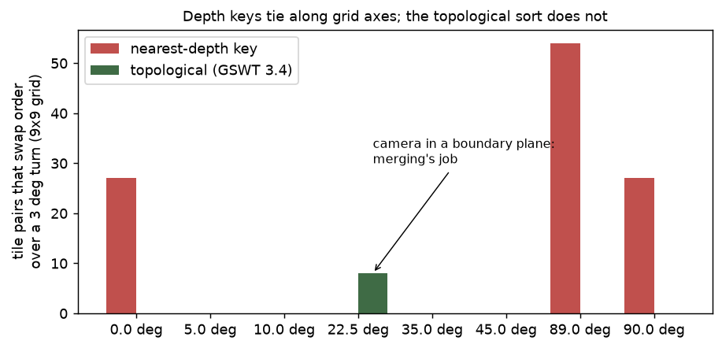

**Selective merging** matches an exact world-space sort to under one bucket
of the 16-bit counting sort. A counting sort over the union beats a k-way
merge: 3.8 vs 9.5 ms at 300k splats, 25.6 vs 76.8 ms at 1.2M.

**On warped terrain, one sorted order per tile is not enough**: 47% of
adjacent pairs come out wrong. Sorting along the view direction in the
tile's own frame gives zero. That frame must be the true Jacobian -
normalising it thins material on slopes by exactly `sqrt(1+|∇h|²)`.

**Scaling** (GTX 1650 Ti): 60 fps to grid 40 (1,600 tiles, 5.5M splats),
30 fps at 48; draw calls are the ceiling (906 at grid 48), not splat count.
With the far field and auto quality, grid 256 × 256 (about 380 m of
ground) stays above 30 fps.

**Erosion.** Stream power carves where droplet erosion only smoothed:
channel network 11.7% → 33.9% of cells, height-drainage correlation
−0.29 → −0.46, and about 100× faster.

**Popping** is not yet measured well: `bozkir/popping.py` undoes camera
motion by phase correlation and block matching (StopThePop uses RAFT and
FLIP), and block matching is integer-accurate - a one-pixel registration
error on splat terrain is larger than the ordering effect. The ordering
result above does not depend on it.

---

## How it works

**Decals.** Distinct pieces of the capture - a shrub and its shadow - are
kept out of the tiles and baked into copies of plain tiles and centres,
inside a disc clear of the edges, then placed sparsely by the layout
(texture bombing, Glanville 2004).

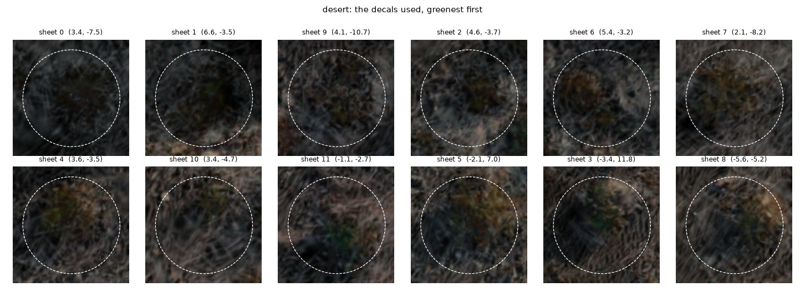

Not every capture can become tiles. `scripts/inspect_ply.py` and
`make_tileset.py`'s verdict screen them. A sea stack is not ground (its
splats are needles: median anisotropy 484), an aerial survey shot around a
subject yields one usable region rather than four, and a synthetic scan has
no material to preserve.

**Terrain.** Fractal noise from an integer hash, Priority-Flood depression
filling, and stream-power erosion solved the FastScape way (Braun and
Willett 2013), with a sediment record the rule can read. Nineteen profiles
in five groups. The Python and JavaScript generators are held to the same
output bit for bit, so a profile and a seed name the same ground anywhere.
Height fields can also come from a drone DSM or from the capture itself;
[terrain.md](terrain.md) maps each step to its source.

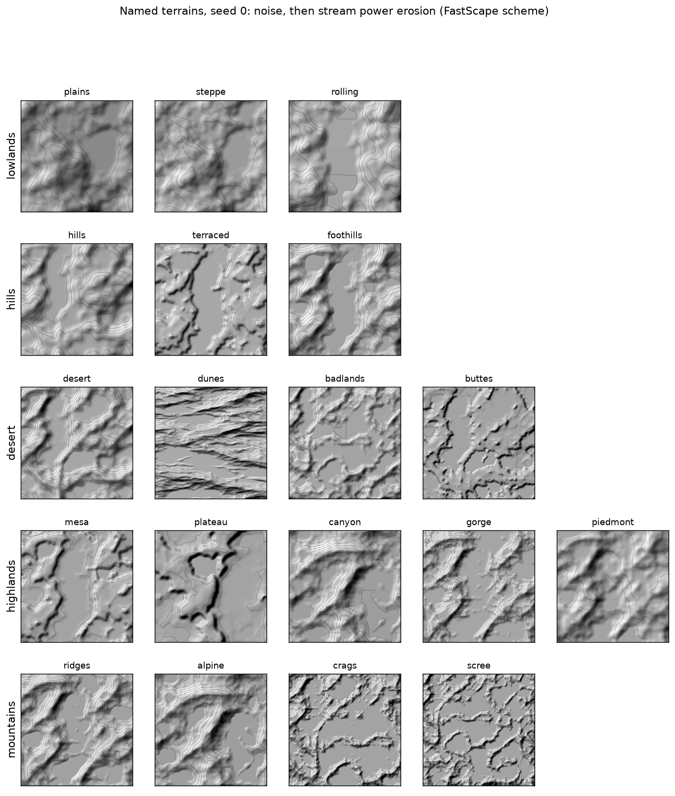

**Renderer.** WebGL2: per-tile counting sort in a worker, Wang layout,
topological tile order, selective merging, warping onto the height field,
LOD with cross-fade. Beyond that:

- **Blending by spot.** Each material has a field on a half-cell grid, read
  at a point displaced by value noise at three scales, so materials reach
  into one another instead of meeting along cell edges; each spot belongs
  to one material, and only a narrow strip dissolves, where the taller and
  more opaque splat wins (height-based blending, Mishkinis 2013).
- **Far field.** Past the splat levels of detail the ground is one mesh
  textured from an atlas of every tile and centre seen from above
  (`scripts/bake_atlas.py`), with the same layout, rule and blend fields -
  one draw call for all distant cells. Chosen over hierarchical 3DGS
  (Kerbl et al. 2024) because the limit here is draw calls, not splat
  count. Opaque, colour matched per tile to the splats, detail fading to
  the tile mean with distance, handed over by a dithered screen door.
- **Auto quality.** About 30 fps the way games do it: render resolution
  first (50-100%), level-of-detail distance only as a slow second lever -
  moving both at once made them chase each other between 20 and 45 fps.
- **Detail relief.** Ridged noise at tile scale, identical in the splats,
  the far field and the camera, masked to steep slopes and convex crests.
- **Ground shading** only darkens where the terrain would (a hollow sees
  less sky), since the capture cannot be relit.
- **Starter scene**: a two-material Wang set made in the page when no data
  loads, or with `?scene=starter`.

---

## The usual objections to splats in games

Practitioners' objections are consistent: no collision, large files,
visible seams where big scenes are split, content that cannot be edited, no
relighting. Where bozkır stands on each:

| objection | bozkır's answer | what remains |
|---|---|---|
| no collision | the ground is a height field, so the collider is the terrain itself - the "render the splats, collide with a hidden mesh" pattern engine users recommend | the tiles' own micro-relief is not in the collider |
| huge files | a kilometre-scale world from a 19.5 MB tileset (three materials: 54 tiles, 27 centres, 0.6M splats across all levels of detail) | the source capture is still large |
| seams when splitting big scenes | Wang tiles are seamless by construction; the far field hands over by dithering | a faint colour step at the hand-over |
| cannot be edited | layout, materials and terrain are procedural: rules, presets and sliders | the captured micro-geometry itself is not editable |
| no relighting | not solved: lighting is baked, ground shading only darkens | a sunny capture repeats its shadows |

Against generative world models (text-to-world, diffusion terrain) bozkır
does not compete on variety. It is *capture-driven procedural*: real
captured appearance, deterministic (a seed regenerates the same world bit
for bit), controllable by rule, and cheap - it runs in a browser on a laptop
GPU with no training.

---

## Limitations

- Lighting is baked into the capture: no relighting, no time of day.
- A drone capture at 3-4 mm per pixel holds up to about a metre away;
  grass that moves in the wind between photos stays soft.
- Water is a level surface over shaded splats, not a simulation; seen very
  low, shallow water reads as an even pale sheet. Rivers follow the
  terrain's drainage, so a small world may only hold pieces of one.
  Shadows in a sunny capture become part of the repeating pattern; overcast
  captures tile better.
- A material with little clean ground yields few patches and few centres,
  and repeats more than the others.
- Class choice is per cell. Blending by spot hides the cell outline, but
  the boundary keeps the scale of the half-cell field.
- `.splat` keeps degree-0 colour only, so view-dependent colour is lost on
  export (mean error 14 on 0-255).
- The far field cannot follow splat size, and a top-down atlas differs from
  grazing views: a faint colour step remains at the hand-over.
- Closed basins become flat floors ([terrain.md](terrain.md)).
- Features in the edge band near a tile corner still repeat; corner tiles
  (Lagae and Dutré 2006) are the known fix.
- The upside-down check is one-way: a warning means something, silence
  proves nothing.
- Sorting and draw-call issue stay on the CPU.
- The rule's only validation is inconclusive: the one survey is a single
  slope (Results 1).

---

